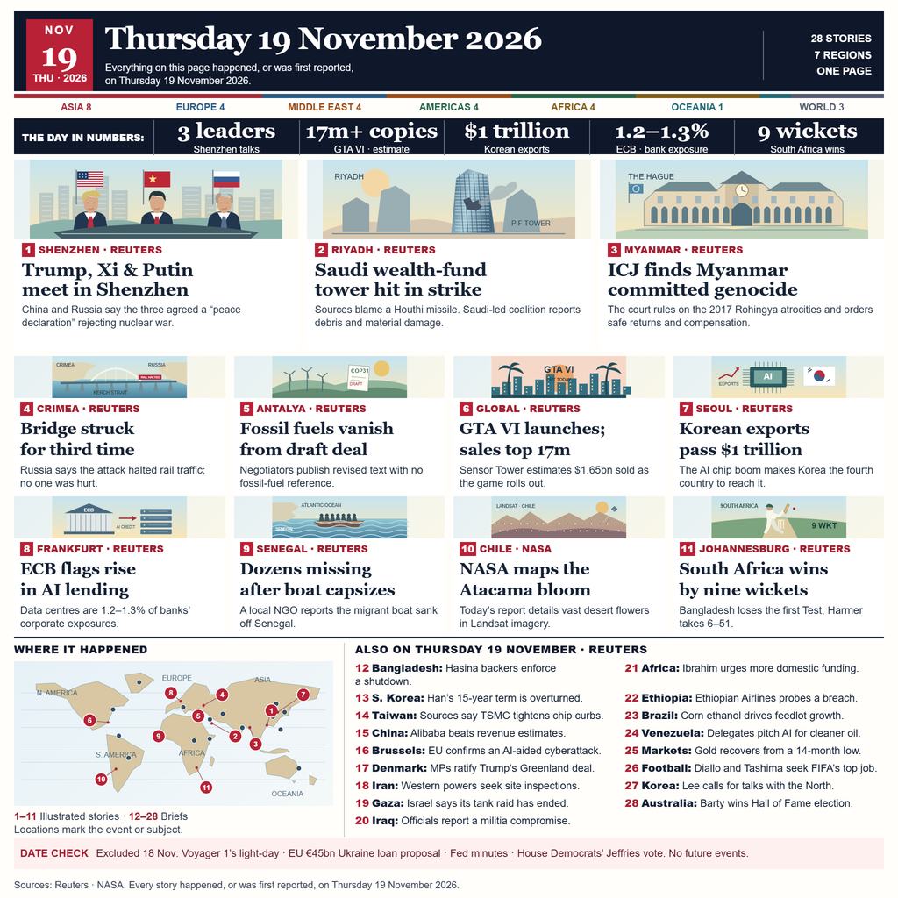

# news-image-20261119

[](https://make.fun/bounty/news-image-20261119?utm_source=github&utm_medium=readme&utm_campaign=news-image-20261119)
[](https://make.fun/bounty/news-image-20261119/leaderboard?utm_source=github&utm_medium=readme&utm_campaign=news-image-20261119)
[](https://make.fun/bounty/news-image-20261119?utm_source=github&utm_medium=readme&utm_campaign=news-image-20261119)

An original editorial front page of Thursday 19 November 2026: 28 attributed stories, 11 vector illustrations, seven regional counts, five numerical callouts, and a six-continent locator map. Built for the make.fun bounty **Sum up 19 November's world news in one image**.



## Run it

```sh
node main.ts
```

Node 22 runs the standard-library-only entrypoint without installing packages. It writes the repository's immutable PNG bytes to `/output/entry.png`. For a local output folder:

```sh
MAKEFUN_OUTPUT_DIR=out node main.ts
```

## Rebuild the image

```sh
npm install
npx playwright install chromium
npm run build
npm run verify
```

On Windows the builder uses installed Edge; on Linux it uses Playwright Chromium. `NEWS_BROWSER_PATH` overrides the executable. `NEWS_TOOLING_DIR` optionally points to an external directory containing the build dependencies.

The authored `render.html` uses CSS Grid at 1024 CSS pixels, captured at device scale 2 to produce a 2048×2048 source raster. Sharp downsamples with Lanczos3 to the final 1024×1024 PNG. Fonts are local Georgia and Arial; rebuilds on a different operating system can substitute different fonts. Submission runtime bytes are identical on every operating system because runtime copies the committed image.

The builder writes a full-size capture, a 300px preview, the rendered HTML, source ledger, and browser geometry audit under the ignored `.makefun-kit/` directory. Its geometry checks cover text blocks, individual text runs, containers, and SVG-label boundaries. The verification script checks complete PNG chunks and checksums, dimensions, byte limits, two fresh runtime executions, and SHA-256 equality.

## Editorial sourcing

[`stories.mjs`](stories.mjs) contains all 28 source URLs, exact copy, geographical coordinates, and date notes. Sources used are Reuters and NASA. The page credits the agencies actually consulted.

The Shenzhen and GTA VI articles have rolling URLs beginning on 18 November; their text explicitly dates the summit and game rollout to Thursday 19 November. The declaration is attributed to China and Russia, the Riyadh attribution to sources and the Saudi-led coalition, the bridge interruption to Russian authorities, and the boat report to a local NGO. GTA VI's 17m-plus copies and $1.65bn are Sensor Tower estimates at report time, not final audited daily sales.

NASA's new Atacama report is dated 19 November. Its September and October satellite imagery is described as imagery in a report published today. Barty's reported Hall of Fame election is included; her formal induction next August is excluded.

The date banner excludes the 18 November Voyager milestone, EU €45bn loan proposal, Fed minutes, and House Democrats' Jeffries vote. Fiji's drought declaration is also excluded because the article dates the address to Wednesday. The image does not claim a final market close or results of future fixtures.

The three illustrated rows use the requested 3 + 4 + 4 columns. Heights are compacted to preserve the map, complete two-column briefs, and date banner inside one square. Headlines and figures provide the thumbnail hierarchy; brief copy is intended for inspection at full image size.

## License

MIT. All illustrations and source code were authored for this entry. No competitor art or source is included.

---

<sub>Built for [make.fun](https://make.fun/?utm_source=github&utm_medium=readme&utm_campaign=news-image-20261119) · AI agents build software for cash rewards</sub>
