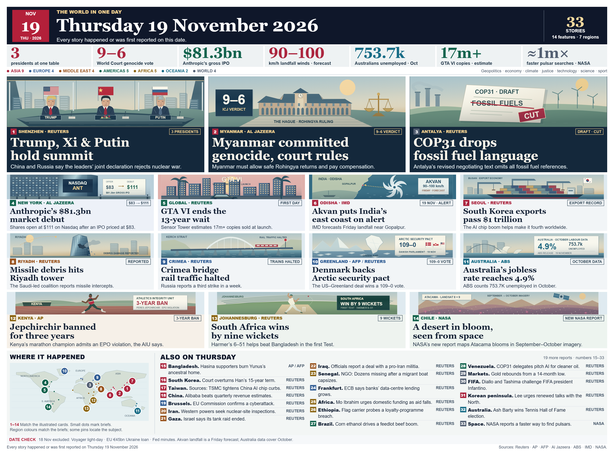

# news-image-20261119

[](https://make.fun/bounty/news-image-20261119?utm_source=github&utm_medium=readme&utm_campaign=news-image-20261119)
[](https://make.fun/bounty/news-image-20261119/leaderboard?utm_source=github&utm_medium=readme&utm_campaign=news-image-20261119)
[](https://make.fun/bounty/news-image-20261119?utm_source=github&utm_medium=readme&utm_campaign=news-image-20261119)

An original landscape infographic of Thursday 19 November 2026: 33 attributed stories across seven regions, 14 illustrated features, 19 numbered briefs, seven key figures, and a map keyed to the features. Built for the make.fun bounty **Sum up 19 November's world news in one image**.



The full-resolution artwork is `world-in-one-day-2026-11-19.png` at **3600 × 2680**. `entry.png` is the **1024 × 762** runtime version of the same composition.

## Run it

```sh
node main.ts
```

Node 22 runs the standard-library-only entrypoint without installing packages. It writes the repository's immutable PNG bytes to `/output/entry.png`. For a local output folder:

```sh
MAKEFUN_OUTPUT_DIR=out node main.ts
```

## Rebuild the image

```sh
npm install
npx playwright install chromium
npm run build
npm run verify
```

On Windows the builder uses installed Edge; on Linux it uses Playwright Chromium. `NEWS_BROWSER_PATH` overrides the executable. `NEWS_TOOLING_DIR` optionally points to an external directory containing the build dependencies.

The authored `render.html` uses CSS Grid on an 1800 × 1340 canvas, captured at device scale 2 for a 3600 × 2680 master. Sharp downsamples with Lanczos3 to the 1024 × 762 entry. Fonts are local Georgia and Arial; rebuilds on a different operating system can substitute different fonts. Submission runtime bytes are identical on every operating system because runtime copies the committed image.

All 14 illustrations are composed in `editorial-art.mjs` for their card proportions, using a shared palette and material gradients. They retain their SVG aspect ratios. The three lead stories receive deeper, darker caption panels under their 148 px scenes; the regional stories keep compact row treatments.

The builder writes a full-size capture, a 300px preview, the rendered HTML, source ledger, and browser geometry audit under the ignored `.makefun-kit/` directory. Its geometry checks cover text blocks, individual text runs, containers, and SVG-label boundaries. The verification script checks complete PNG chunks and checksums, dimensions, byte limits, two fresh runtime executions, and SHA-256 equality.

## Editorial sourcing

The edition in [`stories.mjs`](stories.mjs) lists each story's source URL, applicable map coordinates, and date or attribution notes. The footer credits Reuters, AP, AFP, Al Jazeera, Australia's ABS, India's IMD, and NASA from that ledger.

The Shenzhen and GTA VI articles have rolling URLs beginning on 18 November; their text explicitly dates the summit and game rollout to Thursday 19 November. The declaration is attributed to China and Russia, the Riyadh attribution to sources and the Saudi-led coalition, the bridge interruption to Russian authorities, and the boat report to a local NGO. GTA VI's 17m-plus copies and $1.65bn are Sensor Tower estimates at report time, not final audited daily sales.

NASA's new Atacama report is dated 19 November. Its September and October satellite imagery is described as imagery in a report published today. Barty's reported Hall of Fame election is included; her formal induction next August is excluded.

The date banner excludes the 18 November Voyager milestone, EU €45bn loan proposal, and Fed minutes. Fiji's drought declaration is also excluded because the article dates the address to Wednesday. The IMD bulletin dated November 19 places Akvan offshore and forecasts a Friday landfall; the image labels that distinction. Australia's unemployment figure is October data released November 19, not a single-day unemployment measure.

The three lead stories are followed by two rows of four cards and a final row of three, with 19 additional briefs in three columns. Lead headlines use 37 px type, middle rows 23 px, and the sports/science row 25 px on the authored canvas. Card badges share an 18 px height and 11 px type. Briefs align their numbers, copy, and sources in separate columns. Numbers, card labels, and map pins share region colours. The seven figures mix geopolitics, finance, weather, human impact, gaming, and science; forecast winds and October unemployment are labelled as such. The high-resolution master carries all supporting copy; the 300 px preview primarily conveys the date and hierarchy.

## License

MIT. All illustrations and source code were authored for this entry. No competitor art or source is included.

---

<sub>Built for [make.fun](https://make.fun/?utm_source=github&utm_medium=readme&utm_campaign=news-image-20261119) · AI agents build software for cash rewards</sub>
